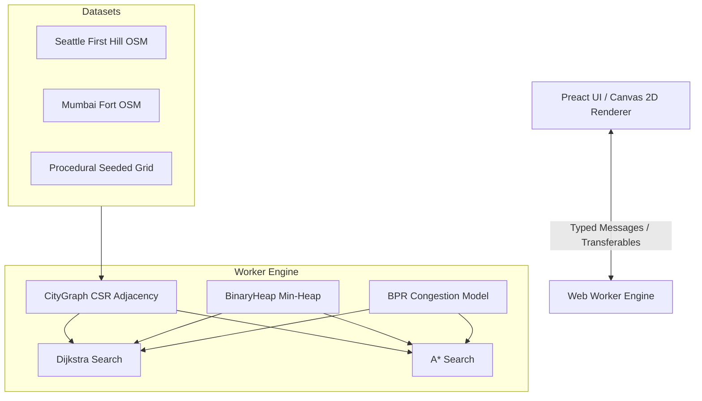

# AEGIS: Interactive Urban Evacuation & Emergency Logistics Optimizer

AEGIS is a lightweight, browser-native simulation and optimization platform designed for urban emergency logistics. Built specifically as a high-impact portfolio project, it allows recruiters and technical assessors to visually comprehend pathfinding and logistics algorithms within 2 minutes.

---

## 🏛️ Problem Statement
During urban emergencies, routing ambulances, managing civilian flows, and re-allocating emergency shelters under dynamic road closures present severe spatial optimization challenges. Standard shortest-path algorithms often perform redundant computation or ignore time-dependent congestion. AEGIS visually contrasts search strategies (e.g. Dijkstra vs A*) on real-world city graphs.

---

## 📐 Architecture



---

## ⚡ Algorithm Overview

| Algorithm | Category | Heuristic / Invariant |
| :--- | :--- | :--- |
| **Dijkstra** | Uninformed Shortest Path | Monotonic priority queue ordering; guarantees optimal path on non-negative edge costs. |
| **A\*** | Informed Search | Admissible Euclidean heuristic ($h(n) = \frac{\text{dist}(n, \text{goal})}{v_{\max}}$); guarantees optimal path while reducing expanded nodes. |
| **BPR Congestion** | Cost Model | Time-dependent congestion penalty: $\text{cost} = t_0 \times (1 + 2.4 \times \text{load}^3)$. |
| **CSR Graph** | Data Structure | Compressed Sparse Row storage for flat array CPU cache locality and zero per-frame allocation. |

---

## 📊 Benchmark & Verification
All algorithms are benchmarked live in the Web Worker.

To run the unit test suite locally:
```bash
npm test
```

To run the production build:
```bash
npm run build
```

---

## 🛠️ Tech Stack & Constraints
- **Framework**: Preact + TypeScript (Strict Mode)
- **Styling**: Pure CSS (Custom CSS Variables, Glassmorphism, Dark Mode)
- **Graphics**: HTML5 Canvas 2D API (60 FPS rendering pipeline, high-DPI display aware)
- **Worker**: Web Workers via standard ES modules with Transferable ArrayBuffers
- **Bundle Budget**: Zero runtime dependencies outside Preact. Total gzipped bundle size < 100 KB.
